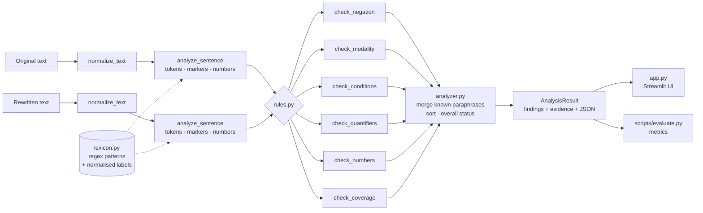

# ClauseGuard

**A critical meaning-drift detector for rewritten college policies and instructions.**

ClauseGuard compares an original sentence with a rewritten version (a summary, paraphrase or
"simplified" notice) and flags places where an important constraint may have been lost or
changed: a dropped *not*, a *must* that became *may*, a missing *unless*, a narrowed *only*, or
a 75 % that became 70 %. Every warning shows the exact words it is based on.

> ClauseGuard reports **potential** meaning drift. A warning is a recommendation to review, not
> proof that the meaning changed — and the absence of warnings is not proof that it was preserved.

It is a rule-based NLP project (regular expressions, lexical analysis, small hand-written
lexicons). It needs no API key, no LLM and no model download.

---

## Motivation and problem statement

Policies are often rewritten: notices are shortened, circulars are summarised, and AI tools
"simplify" rules. Fluent rewrites can silently change what a rule says:

| Original | Rewrite | What changed |
|---|---|---|
| Students below 75% attendance cannot appear for the examination **unless the HOD approves**. | Students below 75% attendance cannot appear for the examination. | exception removed |
| Applicants must have at least **75%** attendance. | Applicants must have at least **70%** attendance. | threshold changed |
| Candidates **must** submit the form before Friday. | Candidates **may** submit the form before Friday. | obligation weakened |
| Students who have **not** paid the fee are ineligible. | Students who have paid the fee are ineligible. | negation removed |

**Problem.** Given an original sentence *O* and a rewritten sentence *R*, identify changes in five
kinds of constraint — negation, modality (obligation/permission), conditions and exceptions,
quantifiers and bounds, and numerical values — and show the evidence for each.

## Key features

- Five explainable checks: **negation & polarity**, **obligation / permission / prohibition**,
  **conditions & exceptions**, **quantifiers, bounds & deadlines**, **numbers, amounts, dates and times**.
- Normalised labels, so equivalent wording is not flagged (*unless* ≈ *except when*, *must* ≈
  *required to*, *Rs. 500* ≈ *₹500*, *15 November* ≈ *November 15*, *seven days* ≈ *7 days*).
- Context checks for common traps: *no more than* and *not later than* are bounds, not negations;
  *not only* is additive; *No. 5* is an abbreviation; *15 May* is a date, not the modal *may*;
  *must not exceed* is an upper bound; *No student may* is a prohibition.
- Transparent severity (HIGH / MEDIUM / REVIEW) assigned by fixed tables in `src/rules.py`.
- Structured JSON output for every analysis.
- A reproducible 152-pair benchmark with dev/test splits and an evaluation script.
- A Streamlit interface with side-by-side highlighting, evidence for every warning and live
  benchmark results.

## Architecture



The engine (`src/`) has no dependency on Streamlit or pandas; the UI and the evaluation script
call the same `analyze()` function.

```
clauseguard/
├── app.py                     Streamlit interface
├── requirements.txt
├── pytest.ini
├── src/
│   ├── __init__.py            exports analyze()
│   ├── schemas.py             dataclasses: Marker, NumericValue, Finding, AnalysisResult
│   ├── lexicon.py             regex patterns and word lists with normalised labels
│   ├── extractors.py          normalisation, tokenisation, marker + number extraction
│   ├── rules.py               one comparison rule per category + severity tables
│   ├── analyzer.py            pipeline, paraphrase merging, overall status
│   └── highlighting.py        HTML highlighting of markers and evidence
├── data/
│   ├── benchmark.csv          152 annotated pairs (generated by build_benchmark.py)
│   └── examples.json          examples shown in the UI
├── scripts/
│   ├── build_benchmark.py     hand-written pairs + annotation guideline + split
│   └── evaluate.py            runs the engine on the benchmark and computes metrics
├── tests/                     pytest suites (77 tests)
└── reports/
    ├── AAT_REPORT_TEMPLATE.md
    ├── evaluation_results.json      generated by scripts/evaluate.py
    └── evaluation_predictions.csv   per-pair predictions
```

## Examples

Output of the real engine for the examples bundled in `data/examples.json`:

| Example | Status | Warnings |
|---|---|---|
| A — missing exception | Potential meaning drift detected | HIGH `COND-EXCEPTION-REMOVED` (*unless the HOD approves*) |
| B — changed threshold | Potential meaning drift detected | HIGH `NUM-CHANGED` (75% → 70%) |
| C — obligation weakened | Potential meaning drift detected | MEDIUM `MOD-WEAKENED` (*must* → *may*) |
| D — negation changed | Potential meaning drift detected | HIGH `NEG-REMOVED` (*not paid* → *paid*) |
| E — "Submit … before 15 November" → "The application must be submitted before 15 November" | No configured checks triggered | – (the imperative *Submit* is treated as an implicit obligation) |
| F — *unless the instructor approves* → *without the instructor's approval* | Manual review recommended | REVIEW `COND-REPHRASED` |

From Python:

```python
from src import analyze

result = analyze("Candidates must submit the form before Friday.",
                 "Candidates may submit the form before Friday.")
print(result.status.value)          # Potential meaning drift detected
for f in result.findings:
    print(f.severity.value, f.rule_id, f.explanation)
print(result.to_json())             # full structured output
```

## Installation

Python 3.11 or newer.

```bash
cd clauseguard
```

```bash
python3.11 -m venv .venv
```

```bash
source .venv/bin/activate
```

```bash
pip install -r requirements.txt
```

(On Windows activate with `.venv\Scripts\activate`.)

## Run the Streamlit app

```bash
streamlit run app.py
```

Open the URL Streamlit prints (usually http://localhost:8501). The app has three tabs:
**Compare** (input, side-by-side highlighting, warnings, JSON download), **Benchmark** (results
from `reports/evaluation_results.json`, with a button to re-run the evaluation live) and
**Method & limits**.

## Run the tests

```bash
python -m pytest
```

77 tests cover each category, the parsers, empty input, JSON serialisation, the evaluation
metrics and a headless run of the Streamlit app.

## Run the evaluation

```bash
python scripts/evaluate.py
```

This prints a report and writes `reports/evaluation_results.json` and
`reports/evaluation_predictions.csv`. Use `--split dev` or `--split test` to evaluate one split,
and `--no-save` to only print. To regenerate the dataset from its source:

```bash
python scripts/build_benchmark.py
```

## Dataset schema

`data/benchmark.csv` — 152 pairs built from 52 hand-written base sentences.

| Column | Meaning |
|---|---|
| `example_id` | `B07-2` = second variant of base sentence 7 |
| `base_id` | base sentence the pair was derived from |
| `original_text` | source sentence |
| `rewritten_text` | rewritten sentence |
| `expected_drift` | 1 if the meaning changed, 0 if preserved |
| `expected_categories` | changed categories separated by `\|` (`negation`, `modality`, `condition`, `quantifier`, `numeric`, `other`); empty when `expected_drift = 0` |
| `mutation_type` | e.g. `negation_removed`, `exception_removed`, `numeric_changed`, `benign_paraphrase`, `unchanged`, `out_of_scope` |
| `split` | `dev` or `test`, assigned per base sentence with a fixed seed (42), 60/40 |

Composition: 93 drift pairs, 59 no-drift pairs (54 benign paraphrases, 5 identical). Two pairs
are labelled `out_of_scope` (*and* → *or*) on purpose, to measure what the detector cannot see.
The annotation guideline is in the docstring of `scripts/build_benchmark.py`.

## Evaluation methodology

- **Pair level (primary).** A pair is predicted as drift if the engine returns at least one
  HIGH or MEDIUM finding. REVIEW findings are not counted. A *strict* variant that also counts
  REVIEW is reported alongside.
- **Category level.** For each category, a pair is a true positive if the category is in
  `expected_categories` and the engine returned a HIGH/MEDIUM finding in that category;
  counted once per pair.
- **Protocol.** Rules were tuned while looking only at dev-split results. The test split was
  evaluated once after the rules were frozen, and the test errors listed below were **not**
  fixed afterwards.

### Results (from `python scripts/evaluate.py`, engine 1.0.0)

| Split | Pairs | Precision | Recall | F1 | Accuracy | TP / FP / FN / TN |
|---|---|---|---|---|---|---|
| Dev (used for tuning) | 87 | 0.981 | 0.963 | 0.972 | 0.966 | 52 / 1 / 2 / 32 |
| **Test (held out)** | **65** | **0.886** | **1.000** | **0.940** | **0.923** | 39 / 5 / 0 / 21 |
| Test, REVIEW counted as drift | 65 | 0.812 | 1.000 | 0.897 | 0.862 | 39 / 9 / 0 / 17 |

Before tuning, the first dev run scored P 0.906 / R 0.889 / F1 0.897. Test-split category
micro-average: P 0.882, R 1.000, F1 0.938 (45 category labels).

**Treat these numbers with caution.** The dataset is small, it was written by the same person
who wrote the rules, and the test split contains no out-of-scope pairs (both happen to be in
dev), which flatters test recall. The numbers show the detector works on the constructions it
was designed for; they do not estimate performance on real-world policy text.

## Known limitations

Test-split false alarms (all benign paraphrases the lexicon does not cover):

| Pair | Why it fails |
|---|---|
| *if they have written permission* → *Provided they have written permission, …* | sentence-initial *Provided* (without *that*) is not in the lexicon |
| *need not attend* → *is optional for* | *optional* is not treated as a negation equivalent, so *not* looks removed |
| *The deadline … is 30 June 2025* → *due by 30/06/2025* | *by* is a new deadline marker; *deadline is* is not modelled |
| *at least three and at most five* → *three to five* | ranges are not modelled |
| *A minimum CGPA … is required* → *need a CGPA of at least 7.0* | *need* + noun is not an obligation marker |

More generally, ClauseGuard does **not** check:

- changes of subject, object or actor (*students* → *staff*) or ordinary content words;
- logical structure and conjunctions (*and* → *or*), or which clause a marker belongs to;
- synonyms and antonyms outside its small lexicon;
- ranges, unit conversions (*one week* vs *7 days*) and relative dates;
- ability vs permission (*can*), epistemic vs deontic *may*, future *will*;
- long passages — it is designed for one sentence or a short instruction.

## Future improvements

- Dependency parsing (e.g. spaCy) to attach each marker to its clause and verb.
- Clause alignment between the two sentences before comparing markers.
- A natural-language-inference model as a *second opinion* for pairs with no rule-based findings.
- Range and unit normalisation (*three to five*, *one week* = *7 days*).
- A larger benchmark written by annotators other than the rule author, with inter-annotator agreement.

## Suggested screenshots

1. Compare tab with Example A loaded: status banner, side-by-side highlighting and the
   "Not found in rewrite: unless" chip.
2. Example G (several changes): the full warnings list with evidence panels.
3. Example F: a REVIEW-only result, to show that paraphrases are not over-flagged.
4. Benchmark tab on the *Test · held out* split: metric table and confusion matrix.
5. Benchmark tab, *Misclassified pairs* section, for the error-analysis slide.
6. Terminal output of `python -m pytest` and `python scripts/evaluate.py`.

## Resume description

> **ClauseGuard — rule-based meaning-drift detector (Python, regex, Streamlit, pandas, pytest).**
> Built an explainable NLP tool that compares an original instruction with its rewrite and flags
> changes in negation, modality, conditions/exceptions, quantifiers and numerical values, with
> evidence for every warning. Wrote a 152-pair annotated benchmark with dev/test splits and an
> evaluation script; on the held-out test split (65 pairs) the detector reached 0.89 precision
> and 1.00 recall at pair level. Covered the engine with 77 pytest tests and built a Streamlit UI.

(If you quote the numbers, also say the benchmark was small and self-constructed.)
