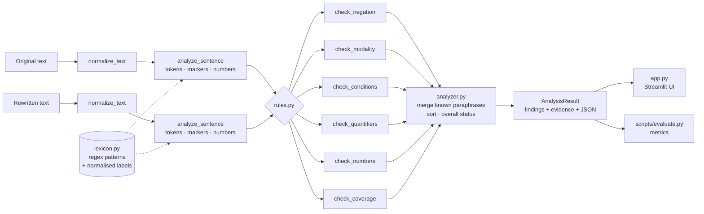

# ClauseGuard: A Critical Meaning-Drift Detector for Rewritten College Policies and Instructions

**Course:** Natural Language Processing — Alternative Assessment Tool (AAT)
**Student name / USN:** `[fill in]`
**Semester / Section:** VII / `[fill in]`
**Guide:** `[fill in]`
**Date:** `[fill in]`

> **How to use this template.** Sections marked **[EXECUTED]** contain results produced by running
> the code in this repository (`python scripts/evaluate.py`, engine 1.0.0, 152-pair benchmark).
> If you change the rules or the dataset, re-run the script and replace these numbers.
> Sections marked **[DESIGNED]** describe experiments that have *not* been run; do not report
> results for them. Placeholders look like `[fill in]`.

---

## 1. Abstract

Rewritten instructions — summaries, simplified notices, paraphrases — can read fluently while
silently changing a rule: a negation disappears, *must* becomes *may*, an exception introduced by
*unless* is dropped, or a threshold changes from 75 % to 70 %. This project presents ClauseGuard,
a rule-based detector that compares an original sentence with its rewrite and reports potential
changes in five kinds of constraint: negation, modality, conditions and exceptions, quantifiers
and bounds, and numerical values. The system uses regular expressions and hand-written lexicons
that map surface expressions to normalised labels, compares the labels found in both sentences,
and assigns each difference a transparent severity (HIGH, MEDIUM or REVIEW) together with the
exact evidence. On a self-constructed benchmark of 152 sentence pairs, the detector achieved a
pair-level precision of 0.886, recall of 1.000 and F1 of 0.940 on the held-out test split
(65 pairs). The benchmark is small and was written by the rule author, so these figures indicate
that the designed constructions are handled, not how the system generalises.

## 2. Introduction

Institutions communicate rules through policies, circulars and notices, and these are often
rewritten for brevity or readability. Whether the rewriting is done by a person or by a
language model, the result can be grammatical and fluent yet differ from the source in a way that
matters to the reader. Many of these differences are carried by small function words — *not*,
*unless*, *only*, *may*, *at least* — or by numbers, which are easy to overlook when reading a
fluent sentence.

ClauseGuard focuses on exactly these words. Instead of trying to judge overall similarity, it
asks a narrower and more explainable question: *which constraint-bearing expressions in the
original are missing, added or changed in the rewrite?*

## 3. Problem Statement

Given an original sentence *O* and a rewritten sentence *R*, identify potentially important
differences in:

1. negation and polarity;
2. obligation, permission, recommendation and prohibition;
3. conditions and exceptions;
4. quantifiers, scope words, numeric bounds and deadlines;
5. numbers, percentages, monetary amounts, dates, weekdays and times;

and, for each difference, report the evidence from both sentences, a severity, an explanation
and a suggested review action. The output must describe findings as *potential* drift and must
never claim that two sentences are semantically equivalent.

## 4. Motivation

- **Consequential errors.** A missing exception can exclude an eligible student; a weakened
  obligation can lead to a missed deadline.
- **Fluency hides errors.** Readers tend to trust well-formed text; errors in function words are
  hard to spot.
- **Explainability.** A reviewer needs to know *why* a pair was flagged. A similarity score alone
  does not say what changed.
- **No external services.** The tool should run offline, without API keys or large models, so
  that it is reproducible and inexpensive.

## 5. Objectives

1. Demonstrate text preprocessing and lexical analysis on policy-style English.
2. Use regular expressions to extract structured values (percentages, amounts, dates, times).
3. Implement explainable marker checks for five categories of constraint.
4. Detect omitted, inserted and changed markers and values.
5. Build a small, reproducible benchmark of original/altered pairs with dev and test splits.
6. Evaluate with precision, recall and F1 at pair and category level.
7. Provide an interactive demonstration interface.

## 6. Related Work

> **Status of references:** the works below are well-known papers in the area, listed from
> memory. **Verify every entry (authors, venue, year, pages/DOI) in Google Scholar or the ACL
> Anthology before submitting**, and remove any you do not read.

- [ ] **Negation detection with rules.** Chapman, W. W., Bridewell, W., Hanbury, P., Cooper, G. F.,
  & Buchanan, B. G. (2001). A simple algorithm for identifying negated findings and diseases in
  discharge summaries. *Journal of Biomedical Informatics*, 34(5). — *NegEx*: trigger phrases and
  scope windows; the closest precedent for ClauseGuard's negation cues.
- [ ] **Modality and negation.** Morante, R., & Sporleder, C. (2012). Modality and negation: An
  introduction to the special issue. *Computational Linguistics*, 38(2).
- [ ] **Natural language inference.** Bowman, S. R., Angeli, G., Potts, C., & Manning, C. D.
  (2015). A large annotated corpus for learning natural language inference. *EMNLP 2015*.
- [ ] Williams, A., Nangia, N., & Bowman, S. R. (2018). A broad-coverage challenge corpus for
  sentence understanding through inference. *NAACL-HLT 2018*.
- [ ] **Paraphrase identification.** Dolan, W. B., & Brockett, C. (2005). Automatically
  constructing a corpus of sentential paraphrases. *Third International Workshop on
  Paraphrasing (IWP 2005)*.
- [ ] **Faithfulness of generated text.** Maynez, J., Narayan, S., Bohnet, B., & McDonald, R.
  (2020). On faithfulness and factuality in abstractive summarization. *ACL 2020*.
- [ ] Kryściński, W., McCann, B., Xiong, C., & Socher, R. (2020). Evaluating the factual
  consistency of abstractive text summarization. *EMNLP 2020*.
- [ ] **Perturbation-based testing.** Ribeiro, M. T., Wu, T., Guestrin, C., & Singh, S. (2020).
  Beyond accuracy: Behavioral testing of NLP models with CheckList. *ACL 2020*. — the benchmark's
  controlled mutations follow the same idea.
- [ ] **Textbook.** Jurafsky, D., & Martin, J. H. *Speech and Language Processing* (3rd ed.
  draft). — regular expressions, tokenisation, lexical semantics.
- [ ] `[Add any references prescribed in your course syllabus.]`

**Positioning.** NLI and paraphrase models output a single label or score for a sentence pair.
Faithfulness metrics for summarisation are trained models. ClauseGuard is deliberately narrower:
it does not decide entailment, but it points to the specific expression that changed, which is
what a human reviewer needs when checking a policy rewrite.

## 7. Methodology

1. **Preprocessing** — Unicode quotes and dashes are unified and whitespace is collapsed
   (`normalize_text`). Character offsets refer to the normalised text so evidence can be
   highlighted.
2. **Tokenisation** — a regular-expression tokenizer keeps contractions (*can't*), hyphenated
   words (*no-dues*) and numbers with separators (*1,500*, *9:30*) as single tokens.
3. **Marker extraction** — for each category, an ordered list of patterns maps surface
   expressions to normalised labels. Longer and negated forms are listed first and claim their
   span, so *must not* is a PROHIBITION and is not also read as the OBLIGATION *must*.
4. **Value extraction** — currency, percentages, dates, weekdays, times and plain numbers (with
   unit nouns) are parsed into comparison keys such as `percent:75` or `date:????-11-15`.
5. **Comparison** — for each category, the multiset of labels in *O* is compared with that of
   *R*. Matching labels cancel out. Remaining removed and added markers are paired when a
   category-specific table recognises the change (e.g. OBLIGATION → PERMISSION), otherwise they
   are reported as removed or added.
6. **Paraphrase merging** — a small number of validated cross-category patterns (e.g.
   *unless X* ≈ *without X* ≈ *if … not X*) replace two opposing HIGH findings with one REVIEW
   finding.
7. **Reporting** — findings are sorted by severity; the overall status is *Potential meaning
   drift detected* (any HIGH/MEDIUM), *Manual review recommended* (only REVIEW) or *No configured
   checks triggered* (none).

## 8. NLP Concepts Used

| Concept | Where it appears |
|---|---|
| **Regular expressions** | All marker patterns (`src/lexicon.py`) and value parsers (`src/extractors.py`), including look-ahead/look-behind for context (`no(?! more than)`, `by(?= Friday)`). |
| **Tokenisation and normalisation** | `tokenize`, `normalize_text`, a minimal suffix-stripping stemmer for matching *submit/submitted*. |
| **Lexical analysis** | Closed-class words (negators, modals, conditionals, quantifiers) are recognised from a lexicon and grouped into normalised classes. |
| **Lexical semantics** | Antonym pairs and negative affixes (*eligible/ineligible*, *non-teaching*); synonymous markers share a label. |
| **Semantic analysis (shallow)** | Modal force ordering (obligation > recommendation > permission), polarity, necessary vs sufficient conditions (*only if* vs *if*), inclusive vs strict bounds. |
| **Scope (approximate)** | The *focus* of a negation is the first content word after the cue; used to detect moved negation (*not paid … can attend* → *paid … cannot attend*). |
| **Ambiguity** | *can* (ability vs permission), *may* (possibility vs permission, or the month), *by* (agent vs deadline), *once* (temporal vs frequency), numeric dates such as 05/06/2025 (day-month order). The system resolves some with context and leaves others as documented limitations. |
| **Constrained natural-language interpretation** | Policy text is a restricted register; the system interprets only the constraint-bearing expressions rather than full meaning. |
| **Evaluation** | Precision, recall, F1, confusion matrices, dev/test splits. |

## 9. System Architecture



| Module | Responsibility |
|---|---|
| `src/schemas.py` | Dataclasses: `Marker`, `NumericValue`, `Finding`, `Evidence`, `AnalysisResult`. |
| `src/lexicon.py` | Ordered regex patterns with normalised labels; word lists. |
| `src/extractors.py` | Normalisation, tokenisation, marker and value extraction. |
| `src/rules.py` | One rule per category; severity tables. |
| `src/analyzer.py` | Pipeline, paraphrase merging, status. |
| `src/highlighting.py` | HTML highlighting for the UI. |
| `app.py` | Streamlit interface. |
| `scripts/evaluate.py` | Benchmark evaluation. |

## 10. Algorithm and Pseudocode

```text
function ANALYZE(original, rewritten):
    O ← NORMALIZE(original);  R ← NORMALIZE(rewritten)
    if O is empty or R is empty:
        return status = MANUAL_REVIEW, findings = [INPUT-EMPTY]
    SO ← DESCRIBE(O);  SR ← DESCRIBE(R)          # tokens, markers, numbers
    findings ← []
    for rule in [negation, modality, condition, quantifier, numeric, coverage]:
        findings ← findings + rule(SO, SR)
    findings ← MERGE_KNOWN_PARAPHRASES(findings)    # e.g. unless ≈ without
    sort findings by (severity, position)
    status ← DRIFT if any HIGH/MEDIUM, else MANUAL_REVIEW if any finding, else NONE
    return status, findings

function DESCRIBE(text):
    for each category c:
        claimed ← ∅
        for each (label, regex) in PATTERNS[c] in order:
            for each match m of regex in text:
                if span(m) overlaps claimed: skip
                add Marker(c, label, m.text, span(m), context(m)); claimed ← claimed ∪ span(m)
    numbers ← PARSE_VALUES(text)    # currency → percent → date → weekday → time → number
    return markers, numbers

function COMPARE_LABELLED(old_markers, new_markers, on_change, on_removed, on_added):
    removed, added ← MULTISET_DIFFERENCE by label
    for each m in removed:
        if some a in added such that on_change(m.label, a.label) is defined:
            report on_change(m.label, a.label) with evidence (m, a);  remove a from added
        else:
            report on_removed(m.label) with evidence (m, none)
    for each a in added:
        report on_added(a.label) with evidence (none, a)
```

Negation uses a specialised version: cues are first paired by the word they negate, then
one-to-one; lexical negatives (*ineligible*) are checked against their positive base word in the
other sentence; leftover cues become `NEG-REMOVED` / `NEG-ADDED`; and paired verbal cues whose
focus words swapped become `NEG-MOVED`.

Numbers are compared by normalised key; leftovers are paired as (a) same date without year →
REVIEW, (b) same value with different unit → HIGH, (c) same value with different type → REVIEW,
(d) same type, different value → HIGH; anything still unmatched is missing (HIGH) or added
(MEDIUM).

## 11. Implementation Details

- **Language / libraries:** Python 3.11; standard library (`re`, `dataclasses`, `json`) for the
  engine; Streamlit for the UI; pandas for evaluation; pytest for tests.
- **Severity policy** (`src/rules.py`):
  - HIGH — negation removed/added/moved, antonym swap, condition or exception removed, deontic
    reversal (e.g. prohibition ↔ permission), bound direction reversed, numerical value changed
    or missing.
  - MEDIUM — obligation weakened or strengthened, *only if* ↔ *if*, new condition or exception,
    inclusive ↔ strict bound, scope change, bound removed or added, new numerical value.
  - REVIEW — changes that are often harmless paraphrases (*if* ↔ *when*, dropping *all* before a
    bare plural, an explicit negation replaced by a negative word, partial dates).
- **Validated context patterns:** *no more than / not later than* (bounds), *not only*,
  *whether or not*, *No.* + digit, *must not exceed* (upper bound), *No student may* (prohibition),
  *by* only before a date or time, *may* not adjacent to a day number, imperatives as implicit
  obligations, *unless* ≈ *without* ≈ *if not*.
- **Value normalisation:** commas and Indian digit grouping (1,00,000), *lakh/crore/k/million*,
  currency symbols and names, rates (*Rs. 10 per day*), 12/24-hour times, *noon/midnight*, dates
  in five formats. Numeric dates are normalised only when the day/month order is unambiguous.
- **Testing:** 77 pytest tests including a headless Streamlit run (`streamlit.testing`).

## 12. Dataset Construction and Annotation

- **Source:** 52 base sentences written to resemble college policies (attendance, examinations,
  fees, hostel, library, laboratories, placements).
- **Variants:** for each base sentence, 2–4 rewrites: controlled mutations (negation removed or
  added, condition/exception removed or weakened, modality changed, numbers changed, quantifiers
  changed), benign paraphrases (voice, word order, synonyms — some deliberately outside the
  lexicon) and a few identical copies. Total **152 pairs**: 93 drift, 59 no-drift.
- **Labels:** `expected_drift` (0/1), `expected_categories` (`|`-separated), `mutation_type`.
  Two pairs are labelled `other` / `out_of_scope` (*and* → *or*) to measure blind spots.
- **Guideline:** see the docstring of `scripts/build_benchmark.py`.
- **Split:** by base sentence (so no variants leak across splits), seed 42, ≈60 % dev / 40 % test
  → 87 dev pairs (31 bases) and 65 test pairs (21 bases).
- **Annotator:** `[fill in — the same person who wrote the rules]`. No inter-annotator agreement
  was measured. **[DESIGNED]** A second annotator could label a random sample and Cohen's κ could
  be reported.

## 13. Experimental Setup

- Engine version 1.0.0; Python `[fill in: python --version]`; OS `[fill in]`.
- Command: `python scripts/evaluate.py` (writes `reports/evaluation_results.json`).
- **Protocol actually followed [EXECUTED]:**
  1. Rules designed before the benchmark split was inspected.
  2. Dev split evaluated: P 0.906, R 0.889, F1 0.897 (11 errors).
  3. Rules revised using only dev errors (8 lexicon/pattern changes, e.g. *not be allowed*,
     *fail to*, *non-* prefix, *restricted to*, rate units, word numbers after bounds).
  4. Dev re-evaluated: P 0.981, R 0.963, F1 0.972.
  5. Rules frozen; unit tests written and passed; test split evaluated once.
  6. Test errors were recorded, not fixed.

## 14. Evaluation Metrics

For a pair-level prediction, TP = drift predicted and labelled, FP = drift predicted but not
labelled, FN = labelled drift missed, TN = correctly not flagged.

$$\text{Precision} = \frac{TP}{TP + FP}$$

$$\text{Recall} = \frac{TP}{TP + FN}$$

$$F_1 = \frac{2 \cdot \text{Precision} \cdot \text{Recall}}{\text{Precision} + \text{Recall}}$$

$$\text{Accuracy} = \frac{TP + TN}{TP + FP + FN + TN}$$

**Matching definition.** Pair level: a pair is predicted as drift when at least one HIGH or MEDIUM
finding is produced (REVIEW excluded; a strict variant includes REVIEW). Category level: a
category is predicted for a pair when at least one HIGH/MEDIUM finding has that category; each
category is counted at most once per pair; micro-averages sum TP/FP/FN across categories.

## 15. Results and Discussion

**[EXECUTED]** Results from `reports/evaluation_results.json` (engine 1.0.0).

**Pair level**

| Split | Pairs | Precision | Recall | F1 | Accuracy | TP | FP | FN | TN |
|---|---|---|---|---|---|---|---|---|---|
| Dev (tuned on) | 87 | 0.981 | 0.963 | 0.972 | 0.966 | 52 | 1 | 2 | 32 |
| **Test (held out)** | 65 | **0.886** | **1.000** | **0.940** | **0.923** | 39 | 5 | 0 | 21 |
| Test, REVIEW counted | 65 | 0.812 | 1.000 | 0.897 | 0.862 | 39 | 9 | 0 | 17 |

**Category level, test split**

| Category | Support | TP | FP | FN | P | R | F1 |
|---|---|---|---|---|---|---|---|
| Negation | 6 | 6 | 1 | 0 | 0.857 | 1.000 | 0.923 |
| Modality | 8 | 8 | 1 | 0 | 0.889 | 1.000 | 0.941 |
| Conditions | 3 | 3 | 1 | 0 | 0.750 | 1.000 | 0.857 |
| Quantifiers | 18 | 18 | 2 | 0 | 0.900 | 1.000 | 0.947 |
| Values | 10 | 10 | 1 | 0 | 0.909 | 1.000 | 0.952 |
| Micro average | 45 | 45 | 6 | 0 | 0.882 | 1.000 | 0.938 |

**Discussion.** `[fill in — suggested points:]`
- Recall on the test split was perfect, but every category has single-digit support and the two
  out-of-scope pairs fell in the dev split, so this mainly shows that the designed mutations are
  caught.
- All test errors are false positives on benign paraphrases, i.e. the detector errs towards
  flagging. For a review tool this is the safer direction, but it costs reviewer time.
- Counting REVIEW as drift lowers precision from 0.886 to 0.812 without improving recall, which
  supports keeping REVIEW as a separate "look again" level.
- The drop from dev (F1 0.972) to test (F1 0.940) is consistent with rules tuned on dev.

## 16. Error Analysis

**[EXECUTED]** Pair-level errors (all splits), from `reports/evaluation_results.json`:

| ID | Split | Type | Rewrite | Cause |
|---|---|---|---|---|
| B17-3 | test | FP | *Provided they have written permission, students can use …* | sentence-initial *Provided* not in lexicon → condition looks removed |
| B24-3 | test | FP | *Attending the orientation programme is optional …* | *optional* is not linked to *need not* → negation looks removed |
| B29-2 | test | FP | *Fee payment is due by 30/06/2025.* | *by* adds a deadline marker; *deadline is* not modelled |
| B34-3 | test | FP | *Every team must consist of three to five members.* | ranges not modelled; bounds and a number word look removed |
| B44-3 | test | FP | *Applicants … need a CGPA of at least 7.0.* | *need* + noun not an obligation marker |
| B36-3 | dev | FP | *… no later than 30 minutes before the start …* | *at least N before* ≡ *no later than N before* needs reasoning |
| B45-1 | dev | FN | *… approved by the class advisor or the HOD.* | conjunction change, out of scope by design |
| B51-1 | dev | FN | *… either the assignment or the lab record.* | conjunction change, out of scope by design |

`[fill in — group errors by cause: lexicon gaps, structures not modelled, out-of-scope phenomena]`

## 17. Limitations

- Lexical, not syntactic: markers are not attached to clauses, so the system cannot tell *which*
  clause a removed *not* belonged to, only that it is gone.
- Small lexicons: synonyms, antonyms and paraphrases outside them cause false alarms or misses.
- No modelling of conjunctions, ranges, unit conversion or relative dates.
- Ambiguous words (*can*, *may*, *will*) are mapped to one reading.
- Designed for single sentences; long passages are not aligned.
- The benchmark is small, synthetic and annotated by the rule author; reported numbers do not
  estimate real-world performance.

## 18. Future Scope

- Dependency parsing to attach markers to verbs and clauses.
- Sentence/clause alignment for multi-sentence documents.
- An NLI model as a second opinion where no rule fires. **[DESIGNED — not run]**
- Range and unit normalisation.
- A larger benchmark from real circulars, annotated by multiple people.

## 19. Conclusion

`[fill in — suggested:]` ClauseGuard shows that a small set of explainable lexical rules can
catch common, consequential changes in rewritten instructions — removed negations, weakened
obligations, dropped exceptions and changed thresholds — while pointing to the exact evidence.
Its errors are concentrated in paraphrases outside its lexicon and in phenomena it does not
model, which marks clear directions for future work.

## 20. References

`[Copy the verified entries from Section 6 in your department's citation style.]`
